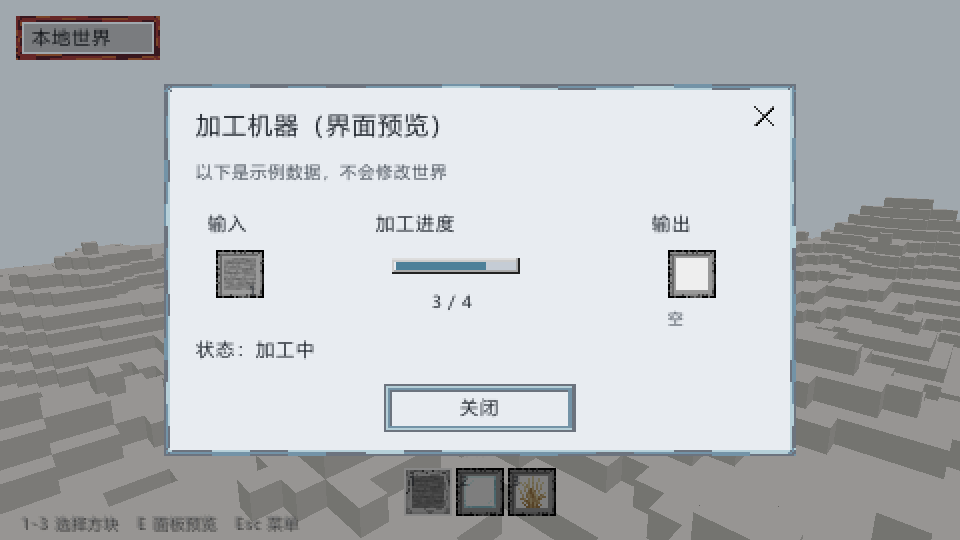
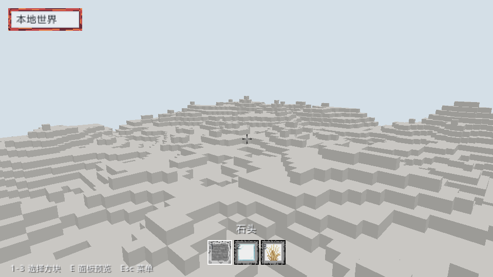
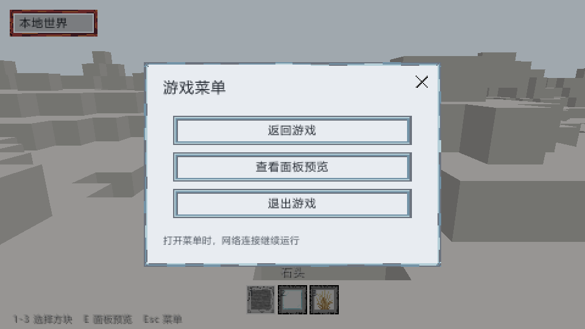

# 客户端UI基础

日期：2026-10-24。环境：Windows，Rust 1.93.1，Vulkan，960x540，NVIDIA GeForce RTX 4080 SUPER。本轮交付客户端界面基础与机器面板预览，不声明B10授权机器UI完成。

## 行为

使用基础游戏的14张PNG：面板、按钮三态、物品槽、进度条、准星、关闭图标及三个物品图标。素材编译时嵌入，解码检查实际尺寸；面板和按钮按九宫格保持边框，界面按1到4倍整数缩放显示。UI通过独立透明混合pass叠加到地形之后，窗口和离屏捕获使用同一绘制代码。

字体由操作系统提供，中文与英文文案从资源文件读取。当前界面状态未改变时，不重新光栅化和上传纹理；字形缓存上限1024。F12截图包含UI，Esc打开菜单，E打开机器面板预览，1到3切换当前方块。模态面板拦截移动与编辑输入，网络轮询继续；失去焦点清空输入，松开先前的鼠标不触发世界操作。

## 画面

机器面板标明示例数据，显示输入、输出、进度与状态，不提供修改真实机器的按钮。



HUD显示当前方块、准星和三格快捷栏，文字带阴影以适应浅色地形。



窗口菜单实际运行9帧并从surface读回PNG，期间actions_ok、actions_rejected和walk_ticks均为0，证明自动捕获未执行世界操作。



## 验证

客户端43项测试通过，其中UI基础新增6项覆盖素材尺寸与解码、九宫格角点与透明度、进度裁切、缩放命中、同一目标按下释放和焦点切换后的输入取消。另有3项客户端测试覆盖滚轮调速和流式装载的溢出回归。真实GPU路径已分别验证机器面板、HUD离屏捕获及窗口菜单截图。

滚轮原先会在后续每帧重复叠乘调速倍率，使相机速度和坐标快速增长，最终在地形生成的区块坐标乘法处溢出。现改为每次滚轮只消费一次倍率，最终速度限制为每秒1到300格。流式装载检查坐标加法，地形生成复用受检坐标转换并验证整个分区范围；不可表示的坐标返回错误，原有效坐标的地形保持不变。

回归模拟3600帧持续飞行和40次以上分区切换，速度保持稳定；地形服务13项测试通过，包含2项新增坐标边界测试。启用Mod后的全工作区511项通过、1项原有测试忽略，格式与适用Clippy检查通过。

交互试玩提供的运行记录为8529帧、118127毫秒、10次流式装载、26次成功编辑和0次编辑拒绝；退出时81个分区与81份网格，未再次崩溃。这是手工功能验证，不作为标准性能基准。

```sh
cargo test -p torse-client --locked
cargo clippy -p torse-client --all-targets --locked -- -D warnings
cargo run -p torse-client -- --capture .work/ui.png --width 960 --height 540 --ui-preview machine
cargo run -p torse-client -- --window --ui-preview pause --frames 8 --screenshot .work/menu.png
```

## 后续

机器进度3/4和输入物品为固定预览值，不代表服务端真实状态。本轮未新增Mod UI描述协议、授权字段投影、机器动作、断线重建或联网移动；这些按B10与A10契约继续接入。窗口resize和DPI对应的物理尺寸决定整数倍缩放；未开展多显示器切换、低端设备或大规模动态文字性能验收。
